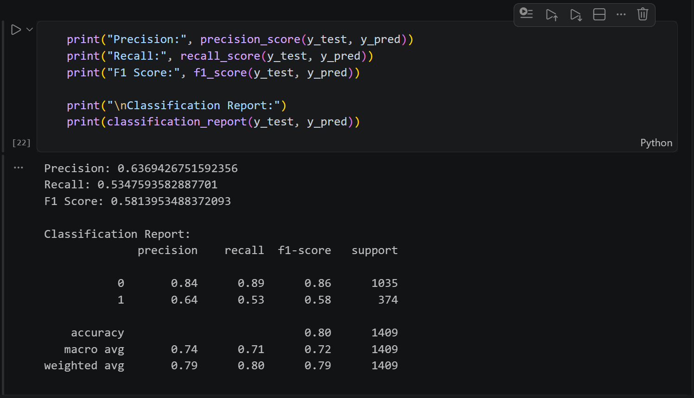
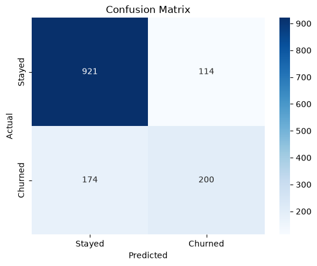
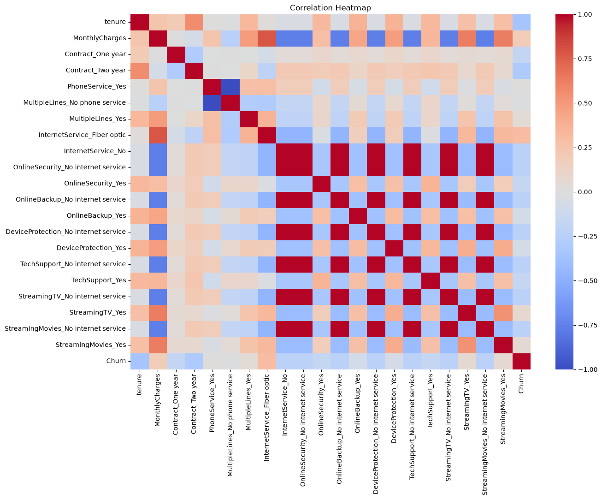

# Telecom Customer Churn Prediction Using Logistic Regression

A machine learning project that predicts whether a telecom customer is likely to leave the company using Logistic Regression.

## 1. Project Description

Customer churn refers to customers discontinuing the services of a company. Predicting churn helps telecom companies identify customers who may leave and take steps to improve customer retention.

In this project, we use Logistic Regression to predict customer churn based on features such as tenure, contract type, monthly charges, and service usage.

**Dataset:** [Telco Customer Churn Dataset – Kaggle](https://www.kaggle.com/datasets/blastchar/telco-customer-churn)

## 2. Team Members and Roles

| Team Member | Student ID | Role |
|---|---|---|
| Janhvi Yadav | 2026EEB1356 | Execution Lead |
| Kinjal Khatri | 2026EEB1366 | PPT Lead and EDA |
| Siddharth Gangwar | 2026MCB1571 | Documentation and Data Preprocessing |
| Amandeep | 2026AIB1007 | Predictions and Model Evaluation |

## 3. Project Structure

```text
telecom-customer-churn/
│
├── WA_Fn-UseC_-Telco-Customer-Churn.csv
├── churn_prediction.ipynb
├── requirements.txt
└── README.md
```

## 4. Setup

Tested on Python 3.14.6 (Windows)

1. Clone the repository:

```bash
git clone https://github.com/Siddharth-122008/telecom-customer-churn.git 
cd telecom-customer-churn
```

2. Create and activate a virtual environment:

```bash
python -m venv venv
```

Windows:
```bash
venv\Scripts\activate
```

macOS / Linux:
```bash
source venv/bin/activate
```

3. Install the required libraries (versions are pinned in `requirements.txt`):

```bash
pip install -r requirements.txt
```

## 5. How to run

1. Start Jupyter Notebook from the project folder:

```bash
jupyter notebook
```

2. In the browser window that opens, click `churn_prediction.ipynb`.
3. Click **Kernel > Restart & Run All**.
4. Wait for all cells to finish (expected runtime: under 1 minute).

The dataset is already included at `WA_Fn-UseC_-Telco-Customer-Churn.csv` and is read using a relative path, so no download is needed.

## 6. Expected Output

The Logistic Regression model predicts whether a telecom customer is likely to churn or stay. The model is evaluated using accuracy, precision, recall, F1-score, and a confusion matrix.

### Model Evaluation Metrics

The model achieves the following results on the test dataset:

| Evaluation Metric | Score |
|---|---:|
| Accuracy | 80.00% |
| Precision (Churn = 1) | 63.69% |
| Recall (Churn = 1) | 53.48% |
| F1-Score (Churn = 1) | 58.14% |

### Classification Report

The classification report provides a detailed performance summary for both classes.

| Class | Precision | Recall | F1-Score | Support |
|---|---:|---:|---:|---:|
| No Churn (0) | 0.84 | 0.89 | 0.86 | 1035 |
| Churn (1) | 0.64 | 0.53 | 0.58 | 374 |



### Confusion Matrix

The confusion matrix shows the actual and predicted customer categories.

- **921:** Customers who stayed and were correctly predicted as stayed (True Negative).
- **114:** Customers who stayed but were incorrectly predicted as churned (False Positive).
- **174:** Customers who churned but were incorrectly predicted as stayed (False Negative).
- **200:** Customers who churned and were correctly predicted as churned (True Positive).



### Correlation Heatmap

The correlation heatmap shows the relationships between the selected input features and the target variable, Churn.

It helps identify patterns and understand how different customer attributes are related to churn.



### Overall Observation

The model achieves approximately 80% accuracy on the test dataset. However, its recall for churned customers is 53.48%, which means some customers who are likely to leave are not identified correctly. This indicates scope for further improvement in predicting customer churn.

## 7. Project Links

- **GitHub Repository:** [Telecom Customer Churn Prediction](https://github.com/Siddharth-122008/telecom-customer-churn)
- **Presentation:** To be added.
- **Project Video:** To be added.

## 8. AI Tools Disclosure

AI tools were used selectively to assist the team during the project:

- **ChatGPT:** Assisted in plotting the correlation heatmap and refining the README documentation.
- **Claude:** Assisted in debugging code, understanding errors, interpreting model results, and preparing the project presentation.

All AI-assisted suggestions were checked by running and reviewing the code, comparing the model results with the notebook outputs, and reviewing the generated content before including it in the final project.
